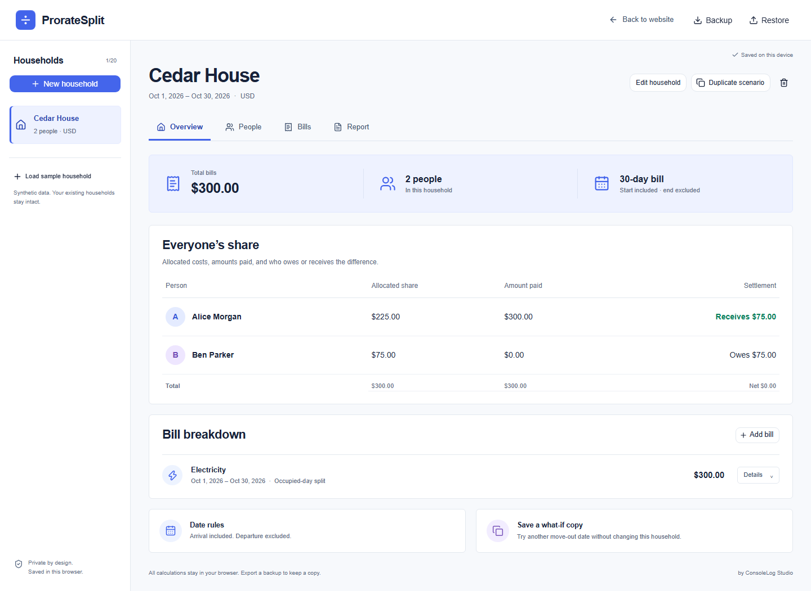

# ProrateSplit

**A fair split. Down to the day.** [Open the live app](https://proratesplit.pages.dev/).

A household bill splitter that explains how move-in and move-out dates change each person’s share. Built by [ConsoleLog Studio](https://consolelog.studio/) as a **self-initiated studio project**, using synthetic demonstration data.



## Run locally

Requires Node.js 24 and npm. The implementation was built with Node 24.14.0 and npm 11.14.1. Exact application and tooling versions are committed in `package-lock.json`.

```sh
npm ci
npm run dev
```

Open `http://localhost:3000`. No environment variables, database account, authentication provider, or API key is needed.

To check the actual production export:

```sh
npm run build
npm run preview
```

Open `http://127.0.0.1:4173`. Next.js exports static HTML, CSS, and JavaScript to `out/`. The preview command serves those files; `next start` is not used for static exports.

## What it does

- Create and rename households, add people with arrival/departure dates, and record who paid each bill.
- Split equally among selected people or split each calendar day among selected occupants present that day.
- Preview a bill’s allocation before saving; inspect the date segments and rounding policy afterward.
- See allocated costs, amounts paid, and net amounts owed or receivable.
- Duplicate a household into an independent, named what-if scenario.
- Print an A4/Letter report or use the browser’s Save PDF option.
- Export and restore a validated JSON backup.

The workspace supports 20 households, 20 people and 100 bills per household. USD and BDT both use two decimal places. The default is USD; choose BDT before adding bills. Currency is locked while a household contains bills. Each bill can be 0–10,000,000.00 and cover 1–366 days.

There are no accounts, cloud synchronization, shared links, payment collection, transfer optimization, analytics, or file uploads.

## Date and money policy

Arrival and billing starts are **included**. Departure and billing ends are **excluded**. Someone departing October 17 last occupied the home on October 16. To cover all of October, use November 1 as the billing end.

The sample covers October 1–30, 2026: its stored end date is October 31. Alice stays all 30 days and Ben arrives October 16. On a 300.00 bill, Alice receives an allocation of 225.00 and Ben 75.00. If Alice paid, her net is −75.00 and Ben owes 75.00.

Occupied-day splitting calculates each day’s equal portion first, rather than dividing the whole bill by total person-days. Exact rational arithmetic uses `BigInt` intermediates. Largest-remainder rounding happens once per person; ties use stable person IDs. Every cent is allocated and settlement balances sum to zero.

Equal splitting ignores occupancy, as explained in the editor. Occupied-day bills cannot contain uncovered days, including when the amount is zero. Occupancy edits that invalidate existing bills cannot save. A payer can be a household member who is not sharing a particular bill.

## Sample, scenarios, and reset

Choose **Try a sample household** on the landing page or **Load sample household** in the workspace. The sample is appended and never replaces existing records. The 20-household limit still applies.

For a useful demonstration:

1. Load Cedar House and review the 225.00/75.00 allocation.
2. Choose **Duplicate scenario** and name the copy.
3. In **People**, set Alice’s departure to October 26 and save.
4. The copy now allocates 200.00/100.00; the original remains 225.00/75.00.
5. Open **Report**, then **Print / Save PDF**.

To remove a sample, select it and use **Delete household**. Confirming removes its people and bills together. Export a backup before deleting anything you need to retain. There is no hidden automatic reset.

## Storage, backup, and recovery

Data is stored in IndexedDB in this browser and site origin. Other devices, other browsers, `localhost`, `127.0.0.1`, preview URLs, and the eventual production domain have separate workspaces. Transfer data with a JSON backup before changing origins.

Browser data can be cleared or evicted; [local storage is not a managed backup](https://developer.mozilla.org/en-US/docs/Web/API/Storage_API/Storage_quotas_and_eviction_criteria). Download backups regularly.

Saves use a revision check and one IndexedDB read/write transaction. A stale tab cannot overwrite a newer save. **Saved on this device** appears only after a transaction completes. If storage fails, valid pending changes remain in memory with **Not saved** and export/copy/retry actions. Keep that tab open until you have a backup. Reload explicitly discards its pending changes.

Restore accepts a ProrateSplit v1 JSON backup up to 10 MiB. The app validates types, dates, counts, unique IDs, references, and calculation invariants before offering a count preview. Download the current workspace first, then explicitly choose **Replace workspace**. Restore replaces the complete workspace, rather than merging it. Invalid or cancelled imports preserve existing data.

Names and bill details are rendered as text. No household contents, imported filenames, or backup bytes are sent to a server. Backups contain the household data in plain JSON; keep them somewhere appropriate for that data.

## Checks

```sh
npm run lint
npm run typecheck
npm test
npm run benchmark
npx playwright install chromium firefox webkit
npm run build
npm run test:e2e
```

On Linux CI, install browser system dependencies with `npx playwright install --with-deps chromium firefox webkit`. Browser tests exercise the production export, including real IndexedDB transactions, stale tabs, simulated quota/transaction failures, backup cancellation/replacement, privacy, mobile overflow, focus restoration, and axe accessibility checks.

For installed Chrome and Edge, set `BRANDED_BROWSERS=1` and run `npm run test:e2e -- --project=chrome --project=edge`. In PowerShell: `$env:BRANDED_BROWSERS='1'` before the command. WebKit testing is not an actual Safari-device check.

See [verification and limitations](docs/verification.md) for measured results and unrun environments. Automated accessibility checks supplement keyboard checks; they are not certification.

To reproduce the portfolio screenshots and walkthrough, start the production preview, then run `npm run capture` in a second terminal. The capture uses a separate synthetic-data browser context. With FFmpeg on PATH it writes `docs/walkthrough.mp4`; otherwise it retains a WebM recording. It never changes your normal browser workspace.

## Implementation and portfolio

- [Architecture and contracts](docs/architecture.md)
- [Case study](docs/case-study.md)
- [Walkthrough and recording](docs/walkthrough.md)
- [Three LinkedIn drafts](docs/linkedin-posts.md)
- [Third-party notices](THIRD_PARTY_NOTICES.md)

## Deployment

The deployment target is **Cloudflare Pages**, using the existing static export. No application server, Pages Functions, paid upgrade, or API secrets are needed. GitHub Actions verifies the source separately from Cloudflare's build.

Connect `shawalkabirchy/ProrateSplit` through the Pages GitHub integration with these settings:

| Setting | Value |
| --- | --- |
| Production branch | `main` |
| Framework preset | Next.js (Static HTML Export) |
| Root directory | Repository root |
| Build command | `npm run build` |
| Build output directory | `out` |
| Build environment variable | `NODE_VERSION=24` |
| Build environment variable | `NEXT_TELEMETRY_DISABLED=1` |

Pushes to `main` trigger production deployments; preview branch deployments and PR comments are disabled. See Cloudflare's [static Next.js guide](https://developers.cloudflare.com/pages/framework-guides/nextjs/deploy-a-static-nextjs-site/) and [build-image version overrides](https://developers.cloudflare.com/pages/configuration/build-image/). Application code does not require a Cloudflare adapter or runtime environment variables.

To run the existing browser suite against an HTTPS deployment in PowerShell:

```powershell
$env:PLAYWRIGHT_BASE_URL = 'https://proratesplit.pages.dev'
npm run test:e2e
Remove-Item Env:PLAYWRIGHT_BASE_URL
```

Without that variable the suite serves the local production export as before. Tests use isolated synthetic workspaces and verify that household data never appears in outgoing requests. Back up local data before moving to the hosted URL: each browser origin has a separate workspace.

## Troubleshooting

- **Storage unavailable:** Allow site storage, leave private browsing if it blocks persistence, or keep working in the current tab and export pending data. Do not clear existing site storage to troubleshoot data you need.
- **Stale workspace:** Export/copy pending changes, then reload the saved workspace. There is no automatic overwrite or merge.
- **Person cannot be deleted:** Edit the listed bills and reassign the payer/participants first.
- **Uncovered dates:** Adjust occupancy, the bill period, eligible people, or choose equal splitting intentionally.
- **Print dialog:** Use the Report tab first; then Print / Save PDF. PDF generation is performed by your browser.
- **Different URL, empty workspace:** Check the origin and browser. Restore a backup to the intended production URL.
