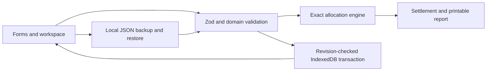

# Architecture

ProrateSplit is a Next.js App Router static export. `/` is a build-time landing page and `/app/` mounts the browser workspace. The application has no HTTP API, server actions, authentication, cloud database, or background service.



## Boundaries

- `src/lib/models.ts` defines record schemas and inferred TypeScript types. Names are trimmed, required fields are non-null, UUIDs and UTC timestamps are checked, and unknown record/envelope fields are rejected.
- `src/lib/calculations.ts` owns decimal parsing, exact allocations, date segments, and settlements. Calendar dates use UTC day ordinals, preserving their calendar meaning across viewer time zones.
- `src/lib/validation.ts` enforces counts, globally unique record IDs, household references, participant/payer references, and complete occupied-day coverage.
- `src/lib/operations.ts` produces validated candidate workspaces without mutating the prior state. Currency locks, referenced-person deletion, household cascade deletion, sample append, and scenario cloning live here.
- `src/lib/storage.ts` is the native IndexedDB boundary. A single database/store/key contains `{ revision, data }`. No unrelated asynchronous work runs inside a live write transaction.
- `src/lib/backup.ts` validates the v1 envelope and complete domain state before replacement. JSON export excludes derived totals and internal storage revision.
- React components own navigation and form drafts. IndexedDB is opened after browser initialization. UI feedback distinguishes saved, pending, conflict, loading, and invalid input states.

## Data contracts

`Household`, `Person`, and `Bill` preserve the P01 brief’s fields. All records carry `id`, `createdAt`, and `updatedAt`.

```ts
type WorkspaceData = {
  households: Household[];
  people: Person[];
  bills: Bill[];
};

type StoredWorkspace = { revision: number; data: WorkspaceData };

type BackupV1 = {
  appId: "P01";
  formatVersion: 1;
  exportedAt: string;
  payload: WorkspaceData;
};
```

No separate scenario entity is needed. A scenario is an independent household copy. Fresh person UUIDs are sorted and mapped in the original person-ID order, preserving rounding tie order. Bill references are remapped to the copied people; subsequent edits affect only that household.

## Exact occupied-day allocation

The engine groups spans with identical occupancy. For each span, its calendar-day portion is split among its selected occupants. This is mathematically equivalent to iterating each day, including vacancy detection.

The least common multiple of occupancy counts 1–20 is 232,792,560. Using it and the bill’s day count gives an exact shared denominator. Numerators use `BigInt`; final stored/displayed allocations are integer minor units. Flooring and largest remainder conserve the bill amount. Stable ID ordering resolves ties.

Stored totals stay within safe integer bounds at the supported limits. A settlement is derived from the household’s complete saved bills, with no partial-period filtering or independently editable totals.

## Persistence and recovery

`saveWorkspace(expectedRevision, nextData)` validates before opening a transaction, reads the committed revision, rejects stale saves, and writes the new complete record and incremented revision atomically. The transaction completion event controls success feedback. Failed writes preserve both the committed database and the valid pending candidate in memory.

An unsupported or unreadable existing record is preserved. There is no migration that clears the database. Format v1 is the only import format; future versions need an explicit migration design.

No uploads or telemetry are part of the application. Browser/site-origin storage isolation is intentional. Local files are read only after explicit selection; downloads use a local Blob URL.

## UI and design

The interface follows the generated white/slate and blue design references: a quiet product header, household rail, open summary band, settlement table, expandable bill calculations, restrained date/scenario notes, and a print-focused report. Controls come from the official shadcn/ui Radix Nova registry. System fonts avoid font-network dependencies.

Required functional additions to the design references are the saved/unsaved status, recovery actions, totals row, destructive-action confirmations, sample append limits, and complete bill/person forms. The landing step numbers are darkened to meet contrast requirements. Mobile tables deliberately scroll within their named region; the page itself must not overflow.
