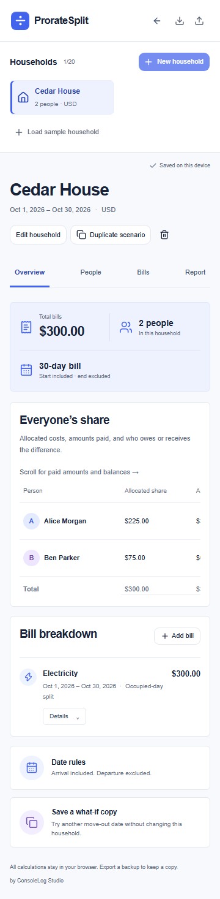
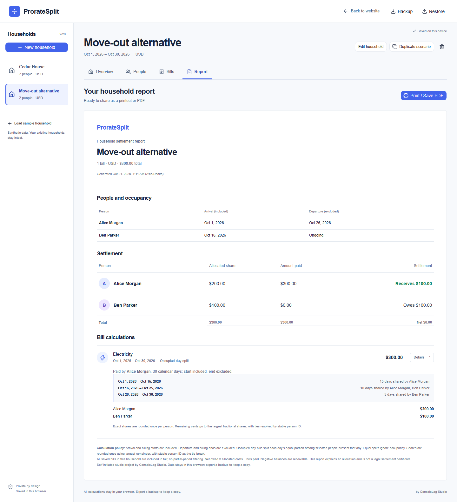

# ProrateSplit: making a shared bill explainable

**Self-initiated studio project · ConsoleLog Studio**

## The problem

When housemates move in or out partway through a billing period, an equal split can be difficult to explain. A useful calculator needs to make dates, amounts, payer balances, and rounding visible enough for someone to review the result.

This project is a portfolio concept for household organizers and a demonstration of the date, money, and reporting work used in rental and service applications. It does not claim a commissioned client, validated demand, or real customer outcomes.

## The product

ProrateSplit lets an organizer add a household, record each person’s stay, add bills, and choose equal or occupied-day allocation. It saves locally, supports independent what-if copies, and produces a readable print report and JSON backup.

1. **Review the result:** Cedar House’s synthetic 300.00 bill allocates 225.00 to Alice and 75.00 to Ben.
2. **Inspect the reason:** The first 15 days belong to Alice alone; the following 15 days are shared.
3. **Try a change:** Duplicate the household and make Alice’s departure October 26. The copy allocates 200.00/100.00, with the original preserved.
4. **Take a copy:** Print the report or export the full local workspace as JSON.

## Decisions that affect the user

**Dates are explicit.** Arrival is included; departure is excluded. The bill editor previews allocation before saving and identifies uncovered dates rather than silently charging someone else.

**Every cent is accounted for.** Exact arithmetic and one rounding step prevent accumulated daily-rounding errors. A 1.00 equal bill split three ways is 0.34/0.33/0.33 in a stable order.

**Daily shares differ from total person-days.** In the sample, dividing the entire bill by total person-days would produce 200.00/100.00. Splitting each day among its occupants produces the intended 225.00/75.00. The interface exposes that policy.

**Saving is honest.** A stale tab cannot overwrite a newer workspace. Failed writes preserve committed records and leave pending changes available to export. Success is shown after the database transaction completes.

**The browser owns the data.** There are no accounts or household uploads. JSON backup is necessary because browser storage can be cleared. The product states that limit directly.

## Implementation and verification

Next.js, TypeScript, Tailwind CSS, shadcn/ui, Zod, native IndexedDB, Vitest, and Playwright. Calculation tests include the canonical examples, varied occupancy, leap years, vacancy rejection, exact rounding, scenario independence, and backup validation. Browser verification covers the production export, responsive layouts, storage conflicts/failures, privacy, and accessibility checks.

The maximum-household calculation benchmark measured a 22.74 ms median on the documented reference laptop. See [verification](verification.md) for the scope of that measurement, actual browser results, and unrun environments.

## Links and scope

- [ConsoleLog Studio](https://consolelog.studio/)
- [Source repository](https://github.com/shawalkabirchy/ProrateSplit)
- Local production demo: run `npm ci`, `npm run build`, then `npm run preview`.
- Hosted demo: awaiting Vercel Hobby eligibility for the intended studio portfolio use.

No payment collection, cloud sharing, legal settlement certification, or automatic reimbursement routing is included.
